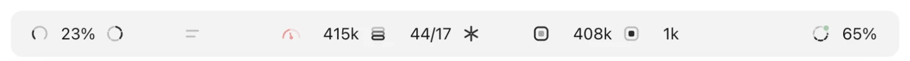

# tview: details

[Back to the short README](../README.md)

A minimal band above the prompt in the Claude desktop app. It shows your limits and the chat's numbers, keeps quiet statistics and answers to `/tview`. Besides the `short` button and the icons that switch chats, it does nothing: no warnings, no notifications, no side effects.

Author: Aleksey Novoselov

<p align="center">
  
</p>

```
 5-hour         this chat                                       week
 arc 3%  ····   gauge · box · snowflake · box · dot · dot   [two lines][stack]   ····  ring 52%
```

The terminal glyph form: `◔ 16% ↺ 3 ○ 70k ◉ 139k ✎ 705 ↑ 4 ↓ 869 △ 59 ◑ 52%`.

How to read the numbers and what to do about them: [CACHE_GUIDE.md](../CACHE_GUIDE.md).

## Icons

Vector icons of one family (16 px grid, 1.5 px stroke, the unfilled part at 28%), drawn by the desktop app. Where the surface draws no vectors (the terminal) the old glyphs come back; the third column shows them.

| Icon | Glyph | What it shows |
|---|---|---|
|  Arc, a three-quarter ring open at the bottom, `73%` | `◔` | How much of the 5-hour limit is spent; the arc fills in 16 steps. The icon and percent are pale green up to 5% (the window just began) and pale red from 96%. |
|  Five segments | `↺` | Time to the 5-hour limit reset, no number: one segment per hour, the nearest one drains by the minute. |
|  Gauge, `658k` | `○` | Tokens the chat's context holds; the needle and the arc show its share of the window (the window size and the percent are not shown). `—` means there is no data yet (a new session or right after `/compact`). The icon turns pale orange from 200k tokens and red from 400k. |
|  Bright box with a grey core, `1.4M` | `◉` | Tokens read from the cache on the last turn. The pair of the next one with the accent swapped. |
|  Snowflake | `△` | Time until the cache cools, no number: six arms, ten minutes each, going dark one by one. All dark means the cache is cold. Until there has been a turn, all are dark. Not a button: it only shows. |
|  Faint box with a bright core, `23k` | `✎` | Tokens written to the cache on the last turn. |
|  Upside-down stack, `17` | `⋯` | Requests to the model the last turn made, right after the cache write. Each tool call is a request, and each one reads the whole context again: this is why a turn can read many times the context. |
|  Dot at the bottom, `62` | `↑` | New input tokens, not from the cache. Normally a few per request, so it shows only from 50 a turn (odd behaviour, a possible cache miss). |
|  Dot at the top, `18k` | `↓` | Generated tokens. |
|  Two lines | `✧` / `✦` | The `short` button: off, both lines are faint; on, the second one is bright and ends in a dot. |
|  Stack, `7/2` | `≡` | How many turns the chat has: your messages with text, without the tool results. When the chat has images the number goes with a slash: `7/2`, the number after the slash being the images (pasted ones and screenshots from tool results). Images are counted as you attach them. |
|  Orbit with dots, `2` | `◈` | How many subagents of this chat are running now (up to four dots on the orbit). Appears right of the stack only while there are some, then goes away. A narrow window drops it last. |
|  Seven segments, `◑` | `◑` | The weekly limit, on the right: one segment per day of the week, filled smoothly by the percent. The number (`85%`) is always shown. |
|  A dot in the corner of the weekly icon | | The subscription renewal (set it with `/tview renew`). Pale green by default, yellow from a week before, red from two days before. While the feature is being tuned the green dot is always shown (`RENEW_ALWAYS` in `hooks/shared.ts`). |
|  Square over a square | `●` | Another chat (see below), coloured by its cache. |

Numbers: `k` is thousands, `M` is millions. Tokens are summed over the whole last turn.

## Statistics

The mod quietly collects numbers (numbers only, message text is never stored) and shows them on `/tview` as a card right in the chat, with a `copy` button. They live in the mod's own store under `stat:…` keys, apart from what the band shows. History starts the day the collector was switched on (the last row of the card says «since»); while the app is closed the mod sees nothing.

| Command | What it does |
|---|---|
| `/tview` | The card for 30 days (in Russian by default; add `en` for English: `/tview en`, `/tview 7 en`). |
| `/tview 7`, `/tview 90`, `/tview all` | The same for another period. |
| `/tview renew 7` | Monthly plan: the day of the month it renews on (the 7th). Yearly plan: `/tview renew 22.10` (day.month). `/tview renew off` removes it, `/tview renew` shows the days left. |
| `/tview reset confirm` | Erase the collected statistics. Without the word `confirm` it only warns. |
| `/tview debug` | Diagnostics for missing dots in a chat: what the refresh keeps, its last problem, and the call made again with its error shown. |
| `/tview help` | A help card in the chat: what each icon means, the buttons (two lines, the stack, the chat icons) and the colours of the chat icons. Russian by default, `/tview help en` for English. |

The card has two parts; a row appears only when there is data behind it:

- **Technical: where the limit and the time go.** The 5-hour windows and their peaks; the weekly limit and the day it runs out; where the tokens go (cache writes, output, new input, agents); how many tokens 1% of the limit is worth; the most expensive chat and the share of the three most expensive ones; the price of a message in short and long chats; a chat's lifetime.
- **How you behave.** Messages per chat (median, mean, record); chats and messages per day; favourite day and hour; nights and weekends; working days and streak; images; marathons (chats longer than 80 messages).

Where the data comes from: messages and images are written when you send, a turn's tokens when it finishes (agents apart); each limit window (5 hours and a week) keeps its highest percent and the moment it reached 95%. Work tokens = new input + cache writes + output; cache reads are cheap and not counted.

A chat's price in percent of the limit is an **estimate**: the chat's work tokens divided by how many tokens 1% is worth on average (all work tokens of the period over the sum of the windows' peaks). That is why those rows carry `≈`. The limit is shared by all chats, while each chat's mod writes only its own numbers, so chats open at the same time do not spoil each other's data.

## Other chats

One icon (a square over a square) left of the weekly limit for every other chat where the app saw activity within the last hour (the time comes from the app's chat list), the freshest on the left. The colour of the icon follows the cache timer's borders: pale green above 15 minutes, yellow from 5 to 15, red under 5. When the cache is cold (an hour without activity) the icon disappears. The icon itself is a button: pressing it makes the mod open that chat's link (`open claude://…` on macOS, `cmd /c start` on Windows) and the app switches to it. The list refreshes every two minutes and after each turn of this chat. The app does not let anything be drawn above the panel itself, so the icons stand in the panel's row and add no height.

## The short button

The two-lines icon in the middle group, set apart from the numbers by a wider gap, with the stack counter right beside it: switch it on (a bright second line with a dot means on; the glyph `✦` in the terminal) and the mod quietly adds a short «answer to the point» prompt to your next message. After sending, the button turns itself off; pressing it again cancels. The prompt's text is `BRIEF_PROMPT` in `hooks/shared.ts`. To remove the feature, delete `BRIEF_PROMPT`, the `brief` atom, the `short` part of the `prompt.submit` hook and the button.

## Saving

- A turn's tokens and `≡` are saved to disk per chat (the last 40) and come back when you re-enter the chat or the mod reloads.
- The chat is never read as a whole. On opening, the message count comes from a counter, and images start at zero and grow as you send them (screenshots from tool results are not counted).

## Text colours

Everything else is black and white (the icons follow the system's light or dark scheme). Exceptions: the 5-hour icon and percent are pale green up to 5% and pale red from 96%; the last hour segment of the reset icon is pale green; the snowflake is pale yellow under 15 minutes and pale red under 5; the context icon turns pale orange from 200k tokens and red from 400k; the icons of other chats are pale green, yellow, red.

## Installation

### What you need
- The Claude desktop app (the Code tab). Claude Code engine **2.1.288 or newer**: it has the `session.measure` event the limits come from. The version is in the chat's «Session info» window (the «Claude Code» row).
- Nothing else: no Node, no build. The mod is a folder of files and the app reads it by itself.

### Install
At the prompt of a terminal session:

```
/plugin install tview --marketplace Milk-Dream-sRGB/tview
```

From a shell:

```
claude plugin install tview --marketplace Milk-Dream-sRGB/tview
```

In the desktop app, where `/plugin` does not run: click **+** next to the prompt box, then **Plugins**, **Add marketplace** with `Milk-Dream-sRGB/tview`, then **Add plugin**.

The first time you are asked `Add marketplace?`: answer `y`, then choose the user scope. After `Installed tview. Plugin is now active.` open or create a chat and type `/tview help`. A help card appears: the mod is loaded, and the band is above the prompt.

### Run it from a folder instead
For trying changes to the files: put the folder somewhere, for example `~/.claude/mods/tview`, then open `~/.claude/settings.json` (create it if it is missing) and add an `env` section (extend it if there already is one):

```json
"env": {
  "CLAUDE_CODE_PLUGIN_DIRS": "~/.claude/mods/tview",
  "CLAUDE_CODE_PLUGIN_DIR_WATCH": "1"
}
```

Quit the app completely (not just the window) and open it again: the variables are read only at start. On Windows the same file is `%USERPROFILE%\.claude\settings.json`; **use forward slashes in the path** (`C:/Users/NAME/.claude/mods/tview`), so nothing has to be escaped.

Windows notes (as of writing only macOS was tested):
- A click on another chat's dot opens the link with `cmd /c start`; on macOS it is `open`. It works if the app registered `claude://` links (it does so on install).
- The icons are vector, so fonts do not change them; they are the same on both systems. Only the terminal glyphs depend on a font. Changing an icon is an edit in `hooks/icons.ts`.
- The statistics live in the app on each machine and do not move between machines.

### If it started but something is missing
- **No band at all.** The app was not fully restarted, or (when run from a folder) the path in `CLAUDE_CODE_PLUGIN_DIRS` is wrong or `settings.json` is broken (check commas and quotes). To check the mod: `claude plugin validate <tview folder>` with the app's engine.
- **Dashes instead of values.** The data arrives after the first reply in a chat; limits are shown only on a subscription.
- **No chat icons.** You need one more non-archived chat where something happened within the last hour (an icon is another chat's warm cache). The mod takes the chat list from the app.
- **`/tview` is not found.** The mod is not loaded: see «No band at all».

### Updating and removing
- Edits to the files are picked up by themselves (hot reload), no restart. The mod's version is in `.claude-plugin/plugin.json`.
- Remove: take the mod out of the Plugins list in the app (or, if you run it from a folder, take the two variables out of `settings.json` and restart the app). The collected statistics stay in the app's store; to erase them, run `/tview reset confirm` before removing.

### Checking the code (for development)
Validation and tests are run with the app's own engine; a separate CLI may lack the `session.measure` event. On macOS:
```bash
"$HOME/Library/Application Support/Claude/claude-code/<version>/<hash>/claude.app/Contents/MacOS/claude" plugin validate tview
"$HOME/Library/Application Support/Claude/claude-code/<version>/<hash>/claude.app/Contents/MacOS/claude" plugin test tview
```
`<version>` and `<hash>` are folder names inside `claude-code`. On Windows the executable sits alongside, in `%APPDATA%\Claude\claude-code\` (the exact path was not checked).

## Layout

Hooks and everything that talks to the engine (`$`) live in one file; the rest is pure and sits apart, with tests (`claude plugin test tview`):

- `hooks/register.tsx` — the mod's only module: state, storage, statistics collection, the `/tview` command and all the hooks.
- `hooks/icons.ts` — the vector icons as SVG markup: pure functions of a value, with the arcs computed (+ `icons.test.ts`).
- `hooks/view.tsx` — the band above the prompt as a tree: takes data and the three press actions (+ `view.test.tsx`: checks everything a person sees and what a press does).
- `hooks/card.tsx` — the `/tview` card as a tree (+ `card.test.tsx`).
- `hooks/tree.ts` — a test helper: stand-in elements so a tree can be read without the engine.
- `hooks/layout.ts` — pure functions: formats, counting, what to drop when space is short (+ `layout.test.ts`).
- `hooks/stats.ts` — data shapes, what each event does to the numbers, the card's computation (+ `stats.test.ts`).
- `hooks/help.ts` — the text of `/tview help` in Russian and English (+ `help.test.ts`: every icon of the band is explained in both languages).
- `hooks/words.ts` — the words of the statistics card in Russian and English.
- `hooks/shared.ts` — the colours, the `short` prompt, the cache lifetime, the language type.
- `types/index.d.ts` — the state types.
- Whatever the engine draws in this place by itself (for example a mascot) stays above the band.
- Limits are shared by all chats through one saved reading (written after each turn). A chat takes it when it opens and when you press the 5-hour or weekly limit; nothing polls it.
- Data sources: `session.measure` (limits and context), `turn.complete` (a turn's tokens), `agent.spawn` and a subagent's `turn.complete` (the `◈` icon), a timer every minute (countdowns and the agent list check), the app's chat list every two minutes (the dots).
- Drawn in `AbovePrompt` as three groups: left, middle (in the true centre) and right. Left: 5h limit, reset, a gap, `short`. Middle: context, turns, the snowflake, agents. Right: cache read and write, input, output, a gap, the other chats' places (two always kept), a gap, the weekly limit. The width is taken from the band's real width.
- Narrow window guard: if the two groups do not fit, the excess is removed whole, not cut with an ellipsis. Order: new input, requests, output, cache write, cache read, stack, `short`, snowflake, orbit, context. The limits, the dots and the weekly limit always stay.

## Settings

- **Cache lifetime.** The `CACHE_TTL_MS` constant in `hooks/shared.ts`. 1 hour by default (a Claude subscription). For an API key set `5 * 60 * 1000`.
- **Colour thresholds.** The `alert` function in `hooks/view.tsx` and the `PALE_YELLOW`, `PALE_RED` constants in `hooks/shared.ts`.
- **Language.** Russian by default; `en` anywhere in the arguments switches the statistics card and the help to English (`/tview en`, `/tview 7 en`, `/tview help en`). To add a language, add an object in `hooks/words.ts` and in `hooks/help.ts`.

## Limitations

- The mod does not know the cache's real lifetime. If the limits are exhausted it drops to 5 minutes while the timer keeps counting an hour.
- After a `/compact` typed by hand the cache cools and the snowflake does not know it.
- Token data appears after the first finished turn.
- The mod is made for the desktop app: in the terminal Claude Code the buttons and dots are drawn differently, which was not checked.
- Statistics are collected only while the app is open and the mod is loaded, and only since it was switched on. A chat's price in percent of the limit is an estimate.
- Windows: the click on a dot and how the icons look were not checked on Windows itself.

## Say thanks

tview is free. If it helped you, you can leave the author a small tip on [Lava Top](https://app.lava.top/seqvo).
